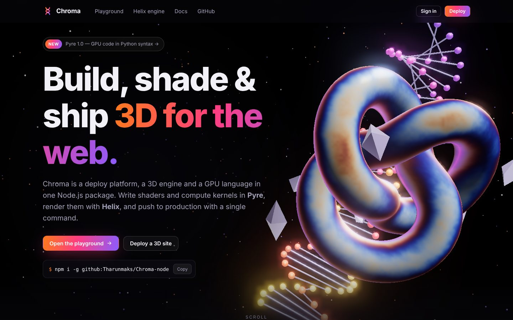
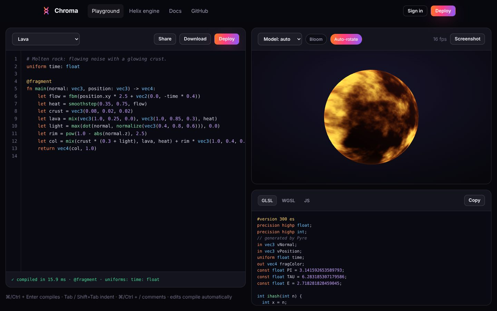
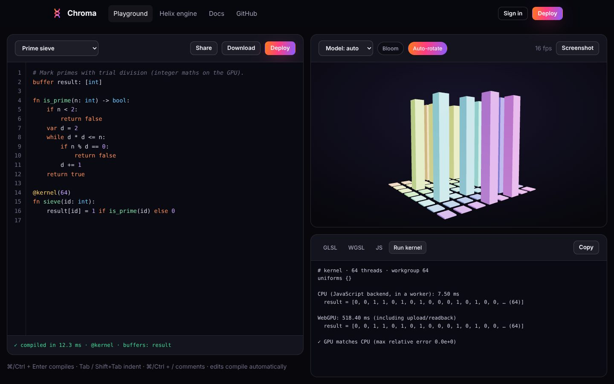

# ◆ Chroma

**Deploy platform · Helix 3D engine · Pyre GPU language — in one Node.js package.**

Write shaders and compute kernels in [**Pyre**](https://github.com/Tharunmaks/Pyre) (GPU code with
Python syntax), render them on 3D models with **Helix** (Three.js with live Pyre materials), and ship
sites to your own server with `chroma deploy` — previews, instant rollback, build logs and HTTP
"Pyre Functions" included.



| Playground: edit Pyre, see it on 3D models | Kernels: CPU and WebGPU, verified equal |
| --- | --- |
|  |  |

## Quick start

```sh
git clone https://github.com/Tharunmaks/Chroma-node && cd Chroma-node
npm install
npm start                       # http://127.0.0.1:3000
```

Open <http://127.0.0.1:3000/dashboard>, create an account, then **New project → Helix starter**.
You'll have a live 3D site (a Pyre lava planet + a Pyre Function) in about a second.

Or use the CLI:

```sh
npm i -g github:Tharunmaks/Chroma-node
chroma init my-site && cd my-site
chroma dev                      # live reload + Pyre compiled on the fly
chroma login                    # API token saved to ~/.chroma/config.json (mode 600)
chroma deploy                   # → /p/my-site/
chroma rollback my-site         # instant rollback
```

## What's inside

| Part | Where | What it does |
| --- | --- | --- |
| **Website** | `web/` | Landing page with a live 3D hero, Playground, Helix studio, Docs, Dashboard |
| **Platform server** | `server/` | Accounts, API tokens, projects, immutable deployments, Pyre build step, sandboxed hosting, Pyre Functions, audit log |
| **CLI** | `bin/chroma.js` | `init`, `dev`, `build`, `login`, `deploy`, `projects`, `deployments`, `promote`, `rollback`, `run`, `server`, `pyre` |
| **Helix engine** | `web/assets/js/helix/` | Three.js wrapper: Pyre materials, glTF loading, bloom, orbit controls, procedural models, render-when-visible |
| **Pyre** | dependency (`pyre-lang`) | Compiler to GLSL / WGSL / JS, from [Tharunmaks/Pyre](https://github.com/Tharunmaks/Pyre) |
| **Templates** | `templates/` | `helix-starter` (3D page + shader + function), `static` |

### Pages

* **`/`** — 3D hero (Pyre iridescent torus knot, DNA helix, crystals, starfield, bloom), live shader
  showcase with compiled GLSL/WGSL, model viewer with glTF drag-and-drop, deploy terminal.
* **`/playground`** — editor with Pyre highlighting, auto-indent and inline errors; live 3D preview on
  8 models or your `.glb`; auto-generated uniform controls; GLSL/WGSL/JS output; kernels run on the CPU
  (in a sandboxed worker) **and** on WebGPU with a correctness check and 3D visualisation; share links;
  one-click deploy.
* **`/engine`** — Helix studio: scenes, Pyre and PBR materials, bloom, instancing, your own models.
* **`/dashboard`** — sign up / in, projects with live previews, drag-and-drop folder deploys, build
  logs, promote/rollback, API tokens, password change, audit log.
* **`/docs`** — getting started, CLI, deployments, Pyre reference, Helix API, REST API, security,
  self-hosting.

## Security

Chroma hosts untrusted sites and runs untrusted GPU code next to your account, so security is
built in rather than bolted on — see [SECURITY.md](SECURITY.md). Highlights:

* scrypt password hashing, constant-time checks, account lockout, per-IP rate limits
* `HttpOnly; SameSite=Strict` session cookies, per-session CSRF tokens, Origin checks; only hashes of
  sessions and API tokens are stored
* strict CSP on every platform page (no inline script except the hashed import map, no eval)
* every deployed file is served with a CSP **sandbox** → user sites run in an opaque origin and can't
  touch the dashboard or API with your credentials
* upload validation (traversal, hidden files, size caps), content-addressed storage
* Pyre Functions in fresh worker threads with time, memory, loop and buffer limits

## Development

```sh
npm test          # 31 tests: auth, CSRF, isolation, uploads, sandboxing, functions, dev server, CSP
npm run dev       # restart on change
```

Requirements: Node.js 20+. Runtime dependencies: `three` and `pyre-lang` (no framework).
Deploy with Docker: `docker compose up -d` (data in the `chroma-data` volume).

MIT licensed.
